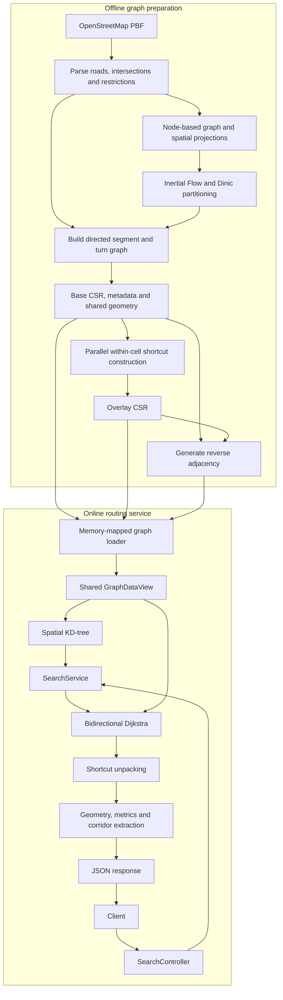
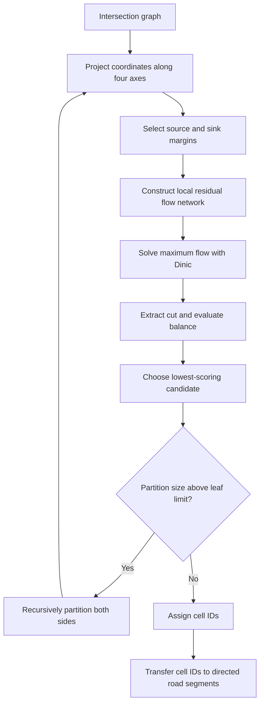
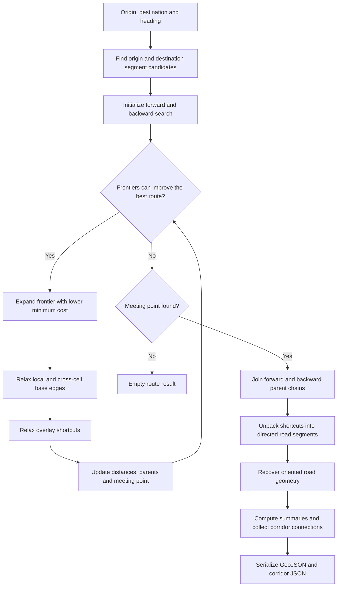

# GeoFlow Map Engine

### Road-network routing with graph partitioning, shortcut overlays, and bidirectional Dijkstra

GeoFlow is a C++ routing-engine project exploring how geographic data becomes a searchable road network. It covers the full path from OpenStreetMap parsing and turn modeling to graph partitioning, shortcut construction, spatial lookup, route reconstruction, and HTTP response generation.

The project brings together **graph algorithms, geospatial processing, memory-conscious data structures, parallel computation, and backend systems design**. This repository presents the implementation and the engineering decisions behind it as a portfolio project.

## Project at a glance

| Area | Implementation |
| --- | --- |
| Language and backend | C++20, Drogon, coroutine-based HTTP controller |
| Road-data processing | Multiple-pass OSM PBF parsing with libosmium |
| Graph modeling | Intersection graph for partitioning; directed segment graph for turn-aware routing |
| Partitioning | Recursive Inertial Flow with Dinic maximum flow/minimum cut |
| Route acceleration | Precomputed entry-to-exit shortcuts within cells |
| Shortest-path search | Bidirectional Dijkstra over base and overlay graphs |
| Spatial indexing | Array-based KD-tree with nearest-neighbor and radius queries |
| Storage | CSR adjacency arrays, packed metadata, shared geometry, POSIX memory mapping |
| Parallel processing | OpenMP across cell-customization tasks |
| Output | GeoJSON route geometry, distance/duration summaries, and a corridor graph |

The local graph artifacts inspected for this project contain:

| Graph component | Count |
| --- | ---: |
| Directed road-segment nodes | 46,836,006 |
| Base turn edges | 131,660,654 |
| Precomputed overlay shortcuts | 12,275,623 |

These figures describe the processed dataset. They are not latency, throughput, or production-capacity benchmarks. Generated map artifacts are excluded from the source repository.

## Engineering focus

| Skill area | How it appears in the project |
| --- | --- |
| Graph algorithm implementation | Dinic flow networks, recursive cuts, Dijkstra search, and shortcut reconstruction |
| Data-structure design | CSR graphs, array-based spatial trees, priority queues, and separate metadata/geometry arrays |
| Geospatial reasoning | Road intersections, directed travel, turn restrictions, geometry orientation, distances, and bearings |
| Systems programming | Binary serialization, packed records, read-only memory mapping, and resource ownership |
| Parallel computation | Independent per-cell shortest-path preprocessing with OpenMP |
| Backend architecture | Controller/service separation, plugin-managed shared graph state, and structured JSON output |
| Performance analysis | Separating preprocessing from query work and examining memory costs at large graph sizes |
| Data engineering | OSM extraction, Overture acquisition, connector-reference validation, and POI exports |

## System architecture

The design separates **offline graph preparation** from **online route queries**. Expensive partitioning and shortcut calculations happen during preparation; query processing reuses those results.



`GraphDataPlugin` owns the mapped graph resources and the spatial index. `GraphDataView` exposes the graph through read-only pointers, while each query maintains its own search state. The controller delegates routing to a service, and payload extraction is separated from JSON serialization.

The diagrams use Mermaid and render on GitHub and in compatible Markdown viewers.

## Graph modeling: intersections, roads, and turns

A road network needs more context than a collection of connected coordinates. A turn may be forbidden even when two roads meet, and traversing a road in one direction may differ from traversing it in the other.

GeoFlow uses two graph representations for different parts of the problem:

| Representation | A node represents | An edge represents | Purpose |
| --- | --- | --- | --- |
| Node-based graph, or NBG | A physical intersection | A road segment | Spatial partitioning |
| Edge-expanded graph, or EBG | A directed road segment | A permitted transition onto another segment | Routing with arrival-road context |

For example, if travel from road A onto road B is prohibited, the corresponding A → B transition can be omitted from the expanded graph. If it is allowed but incurs a delay, that transition can carry a penalty.

The current routing weight convention is:

```text
cost(u → v) = turn_penalty(u, v) + segment_travel_time(v)
```

Travel times are stored in integer seconds, and lengths in integer metres. The baseline parser assigns a 2-second ordinary-turn penalty and a 45-second penalty to turns it classifies as U-turns. It processes supported via-node `no_*` and `only_*` restrictions when creating transitions.

Road shape is stored separately from graph connectivity. Opposite travel directions can reference the same coordinate sequence, with an orientation flag determining the order used during route reconstruction.

**Source:** [Graph structures](include/GraphStructures.hpp) · [OSM graph construction](parsing/parser2.cpp)

## Partitioning: breaking a large graph into cells

The partitioner groups intersections into cells so that route search can work with a smaller set of boundary connections across distant regions.

### Inertial Flow and Dinic

The implementation projects intersection coordinates along four axes:

- Longitude
- Latitude
- Longitude + latitude
- −Longitude + latitude

For each axis, it considers source/sink margins of **10%, 20%, and 30%**, producing twelve candidate configurations. Dinic's algorithm solves the corresponding flow problems, and the partitioner evaluates the resulting cuts using:

```text
cut_score = number_of_cut_edges / size_of_smaller_partition
```

The selected cut is recursively applied until each leaf contains at most **5,000 intersection nodes**. Directed road segments inherit the cell assignment of their originating intersection.



This stage combines spatial information with graph connectivity: coordinate projections guide the candidate cuts, while the flow network determines how roads connect across them.

The query implementation uses a base graph plus **one overlay level**. The partitioner is recursive, but the current runtime does not expose a hierarchy of nested overlay levels.

**Source:** [Dinic partitioner](partitioning/Dinic_Partitioner.cpp)

## Shortcut preprocessing

Once the graph has cell assignments, the customizer identifies:

- **Entry nodes:** segments receiving a transition from another cell.
- **Exit nodes:** segments with a transition leaving their cell.

For each entry, a Dijkstra search restricted to that cell finds the cheapest reachable exits. Those costs become overlay edges.

A query can then traverse an intermediate cell through its boundary shortcuts without exploring every interior road. The full interior path is recovered later when constructing the route geometry.

Customization tasks are parallelized across cells with OpenMP. Forward and reverse adjacency are generated for both the base graph and the overlay, supporting search from both ends of a route.

This separation reflects a central design decision: spend computation once on reusable local connections, then reuse those connections across route requests.

**Source:** [Overlay graph constructor](partitioning/OverlayGraphConstructor.cpp) · [Reverse graph generation](parsing/reverse_graph_generator.cpp)

## Route-query logic

A route request moves through spatial lookup, accelerated search, reconstruction, and serialization.



### Spatial lookup

The spatial index is an array-based KD-tree constructed with recursive median selection. It supports nearest-neighbor and radius queries without allocating a separate object for every tree link.

Origin lookup considers nearby segment representatives through a radius query and a heading-scoring interface. Destination lookup uses nearest-neighbor search. The current representatives are stored geometry points; projecting onto the interior of a road segment remains an extension.

The heading-scoring function currently uses a placeholder road bearing, so the existing implementation does not yet provide reliable heading-based direction selection.

### Bidirectional search

The routing engine maintains separate distance arrays, parent arrays, and minimum-priority queues for forward and backward search. At each iteration, it expands the frontier with the lower minimum cost.

Base edges are available within the source/destination cells and across cell boundaries. Overlay edges provide precomputed connections through cells. Backward expansion reads the reverse graph rather than assuming road connections are symmetric.

When the two searches reach a common node, the engine updates its best meeting cost. It terminates when the frontier lower bound cannot improve the best route, or a search queue is exhausted, and reconstructs the abstract path from the parent chains.

### Shortcut unpacking

The abstract path can mix direct base transitions and overlay shortcuts. For a shortcut hop, a local Dijkstra search recovers the underlying segment sequence inside the cell.

This keeps the shortcut representation compact: overlay records store destination and weight, while reconstruction performs additional local work to recover detail.

**Source:** [KD-tree](map_server/search/kd_tree.cc) · [Routing and reconstruction](map_server/search/multi_level_dijkstra.cc)

## Storage and memory design

The storage model separates the data needed for graph traversal from the data needed to describe and draw a route.

| Component | Representation | Design purpose |
| --- | --- | --- |
| Base adjacency | CSR offsets and contiguous edge records | Traverse neighbors without per-node adjacency allocations |
| Overlay adjacency | CSR offsets and shortcut records | Reuse precomputed boundary connections |
| Segment metadata | Packed records with IDs, costs, flags, and geometry references | Keep route attributes separate from graph edges |
| Geometry | Shared flat coordinate array | Reuse road shapes across directed representations |
| Runtime access | Read-only POSIX memory maps | Share access to graph files without copying the entire dataset into vectors |
| Query workspace | Per-request distance, parent, and queue state | Keep mutable search state separate from shared graph data |

For node `u`, outgoing CSR edges occupy:

```text
edges[head[u] ... head[u + 1] - 1]
```

Base and shortcut edge records each contain a `uint32_t` destination and weight. Segment metadata retains the original OSM way ID, endpoint IDs, travel time, physical distance, cell ID, road classification, direction flags, and coordinate-array references. On the expected platform, the packed metadata record occupies **53 bytes**.

Memory mapping reduces application-side copying, while resident mapped pages still consume physical memory. The KD-tree also resides in RAM. At the inspected dataset size, the four full-node distance/parent arrays require approximately **715 MiB per query**, before queues and output. This makes query-workspace design an important next optimization for concurrency.

**Source:** [Graph data view](map_server/load_data/GraphDataView.hpp) · [Data loader](map_server/load_data/DataLoader.cc) · [Memory-map ownership](map_server/load_data/MMapFile.cc)

## Backend and route output

The backend has four main responsibilities:

| Component | Responsibility |
| --- | --- |
| `GraphDataPlugin` | Own graph resources and initialize the spatial index |
| `SearchController` | Receive route parameters through the HTTP layer |
| `SearchService` | Coordinate snapping, graph search, and response generation |
| `NavigationPayload` | Carry route geometry, summaries, and corridor data before serialization |

The route interface accepts origin/destination coordinates and an origin compass heading. Its response has two main parts:

```text
Route response
├── geojson
│   └── FeatureCollection
│       └── Route LineString and distance/duration properties
└── corridor
    ├── route_path: ordered internal segment IDs
    ├── edges: outgoing connections from route segments
    └── nodes: segment positions and bearings
```

GeoJSON coordinates follow `[longitude, latitude]` order. Geometry extraction respects each segment's orientation flag. The corridor includes alternative outgoing connections along the selected route, providing a data structure for downstream navigation experiments.

The controller uses C++20 coroutine syntax; the routing calculation itself currently runs synchronously. Reported duration sums segment times, while the search objective also includes turn penalties.

**Source:** [Controller](map_server/search/SearchController.cc) · [Service and serialization](map_server/search/SearchService.cc) · [Payload structures](map_server/search/multi_level_dijkstra.h)

## Supporting geospatial work

The repository also explores the data and presentation layers surrounding route computation:

- **OSM location extraction:** exports named locations and their metadata to CSV using libosmium and JSON serialization.
- **Overture places processing:** uses DuckDB spatial queries to extract places, normalize contact/address information, and produce structured exports.
- **Transportation acquisition:** a notebook extracts Overture segments and connectors, records schemas and checksums, and validates that connector references resolve.
- **Map visualization:** a MapLibre page demonstrates a vector-basemap presentation layer backed by an external tile service.
- **Algorithm experiments:** standalone implementations explore maximum flow, partitioning, KD-trees, and route-legality checks.

The current routing graph is built from OSM. The Overture transportation notebook is a separate acquisition workflow; its Parquet output is not yet integrated into the routing graph builder. Corridor export is implemented, while backend HMM/Viterbi matching and live navigation sessions remain future work.

**Source:** [OSM extraction](data/dataIngestion.cpp) · [Overture places](data/overture_data.py) · [Transportation notebook](pre_processing/preprocess.ipynb) · [Map viewer](map_tile_serving/view.html)

## Source-code map

| Directory | Main area of work |
| --- | --- |
| [`include/`](include/) | Shared offline graph structures |
| [`parsing/`](parsing/) | OSM parsing, binary graph generation, and reverse adjacency |
| [`partitioning/`](partitioning/) | Flow-based partitioning and overlay customization |
| [`map_server/load_data/`](map_server/load_data/) | Memory mapping, graph views, and spatial-index initialization |
| [`map_server/search/`](map_server/search/) | HTTP routing flow, spatial queries, shortest paths, and reconstruction |
| [`map_server/plugins/`](map_server/plugins/) | Shared graph lifecycle |
| [`map_server/math/`](map_server/math/) | Geographic math helpers |
| [`search/`](search/) | Earlier standalone routing and spatial-index prototypes |
| [`data/`](data/) | Location and POI extraction |
| [`pre_processing/`](pre_processing/) | Overture acquisition experiments |
| [`exp/`](exp/) | Algorithm prototypes and verification experiments |
